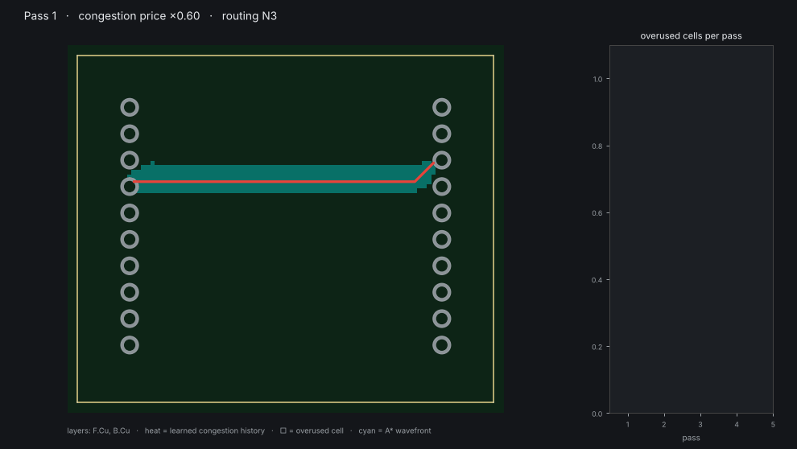
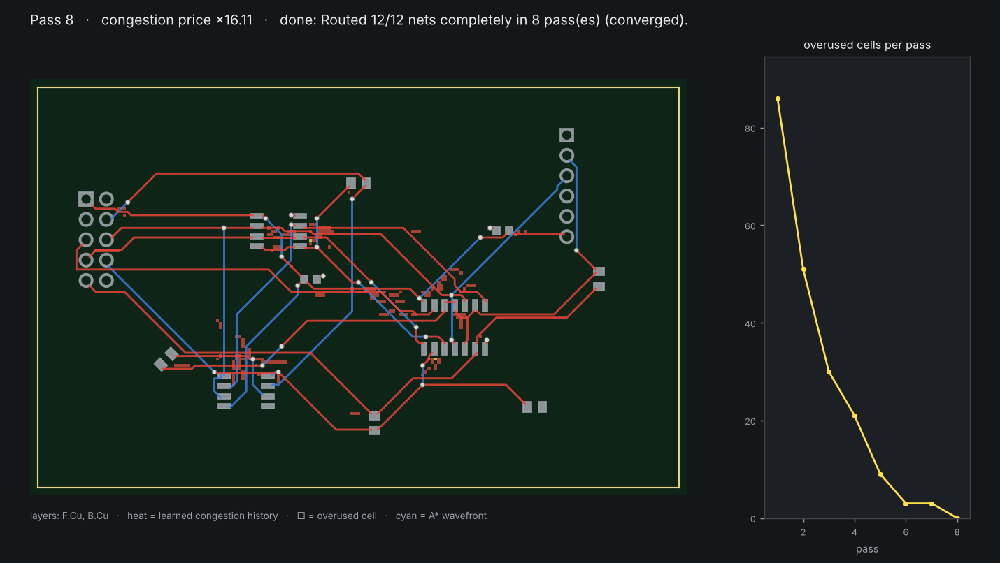
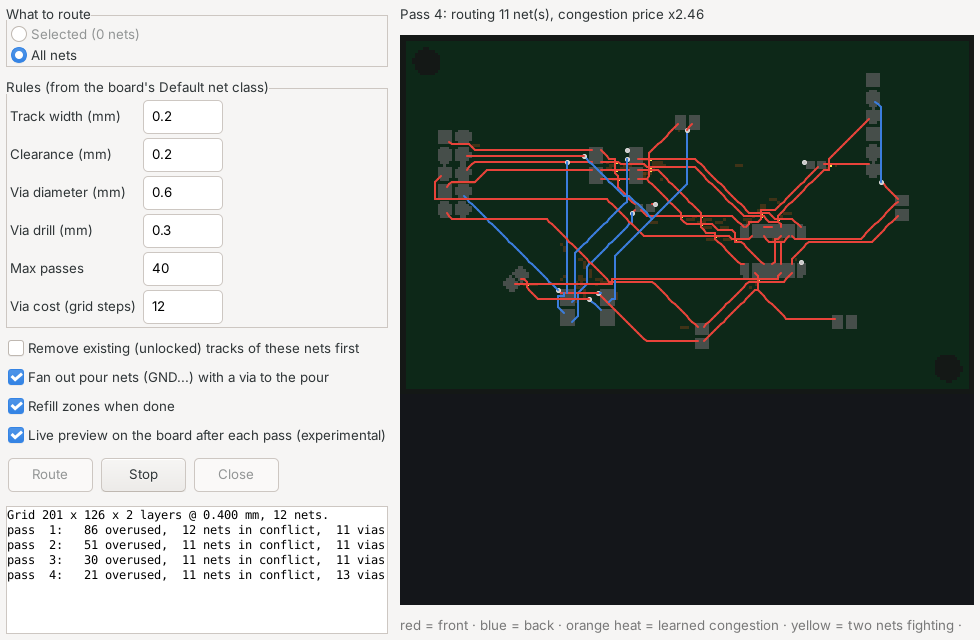

# Visible Autorouter for KiCad

A multi-pass PCB autorouter that runs **inside KiCad** (toolbar button) or from the
command line, routes **all nets or just the ones you select**, and **shows its
thinking** while it works.



*Pass 1: every net takes its own shortest path and nets pile on top of each other
(yellow squares). Each later pass raises the price of contested copper. The
orange heat is the congestion "memory" the router has learned. Nets that have
alternatives move away; the curve on the right shows the overuse falling to
zero.*

## What it does

* **Route all, or route the selection.** Select footprints, pads or tracks in
  the editor, and only their nets are routed. Existing copper is respected:
  already-connected pieces count as one terminal, and other nets' tracks are
  obstacles.
* **Multiple passes.** It uses the negotiated-congestion "PathFinder" algorithm
  with A* search per connection, which is the standard method for FPGA routing.
* **Visible thinking.** You can watch the A* wavefront, tentative tracks,
  overused cells, the learned congestion heatmap, and a convergence curve,
  either in the plugin's live panel, in a matplotlib window, or as a GIF.
* **Pours are part of the negotiation.** GND/power nets with a copper zone are
  left to the pour. SMD pads that are not on the pour layer get a short stub
  plus a via down to it. After each pass the router estimates the pour,
  detects pads or vias stranded on islands, and pushes the tracks that cut
  them off elsewhere.
* **Checked with KiCad's own DRC.** On the demo board the result has
  **0 clearance, short, edge or hole violations and 0 unconnected items**.
  The test suite runs that check.



## How it thinks

The board becomes a grid whose pitch is `track width + clearance`. Tracks run
along cell centres, so *one cell = one net* **is** the clearance rule. Two extra
rules keep that true everywhere else:

* a 45° step also claims the two cells it squeezes past (it passes only 0.707
  pitch from their centres);
* a via claims every cell within `via radius + clearance + track width/2`, on
  every layer.

Pads, existing tracks and the board edge give each cell an owner: free, "only
net *n*" (inside *n*'s clearance halo), or blocked.

Each pass then does this:

```
for each net that is in conflict:              (all nets in pass 1)
    rip up its old route
    grow a tree from one pad; repeatedly A* to the nearest unconnected pad
        cost of a cell = (1 + history) × (1 + present_factor × other_nets_in_cell)
        × direction factor (F.Cu prefers horizontal, B.Cu vertical) + bend + via costs

after the pass:
    overused cell  = used by 2+ nets
    history       += history_factor × overuse        (remembers chronic hot spots)
    present_factor ×= 1.6                             (contention gets pricier every pass)
    pour check: a pour pad/via cut off onto an island → its walls get pricier too
stop when nothing is overused
```

This works like a market. Copper is a shared resource and its price rises with
demand. Nets with cheap alternatives leave the contested cells. Nets with no
alternative stay, because everyone else has learned to avoid that spot. The
present-cost factor only ever rises, so it also resembles annealing: the
system gradually "freezes" into a legal solution. If it hasn't converged after
`max_passes`, the most-conflicted nets are dropped and reported, so the output
is always DRC-legal.

## Install in KiCad

1. In the PCB editor: **Tools ▸ External Plugins ▸ Open Plugin Directory**.
2. Copy (or symlink) the `kicad_autorouter` folder into that directory.
3. **Tools ▸ External Plugins ▸ Refresh Plugins**. A toolbar button appears
   (two crossing traces).



Select what you want routed, or nothing at all, and click it:

* Rules come from the board's Default net class, and you can edit them in the
  dialog.
* **Route** starts. **Stop** keeps the best result so far.
* Everything the router adds is a single undo step (**Edit ▸ Undo**).
* Optional: remove existing tracks of these nets first, fan out pour nets,
  refill zones, and live preview on the board after each pass.

## Command line (no KiCad GUI needed)

```bash
python -m kicad_autorouter board.kicad_pcb -o routed.kicad_pcb
python -m kicad_autorouter board.kicad_pcb --nets SDA,SCL           # only these nets
python -m kicad_autorouter board.kicad_pcb --gif thinking.gif       # record the thinking
python -m kicad_autorouter board.kicad_pcb --live                   # watch in a window
```

The CLI reads the `.kicad_pro` next to the board for the Default net class.
Options include `--track-width --clearance --via-diameter --via-drill --grid
--layers F.Cu,B.Cu --passes --via-cost --include-zone-nets`. The core is pure
Python with no dependencies. Only `--gif/--png/--live` need matplotlib (and
Pillow for GIFs).

As a library:

```python
from kicad_autorouter import route, RouteSettings
from kicad_autorouter.kicad_pcb import PcbFile

pcb = PcbFile("board.kicad_pcb")
result = route(pcb.board(), pcb.settings_from_project(), nets=["SDA", "SCL"],
               callback=lambda ev, data: print(ev, data.get("pass")))
pcb.add_routes(result, pcb.settings_from_project()); pcb.save("routed.kicad_pcb")
```

## Layout

| file | what |
|---|---|
| `kicad_autorouter/model.py` | board model (pads, tracks, vias, outline) in mm, plus `RouteSettings` |
| `kicad_autorouter/problem.py` | board → grid, clearance halos, terminal clustering, pour anchors |
| `kicad_autorouter/router.py` | A*, PathFinder passes, pour check, events, geometry output |
| `kicad_autorouter/viz.py` | matplotlib live view / GIF / PNG |
| `kicad_autorouter/kicad_pcb.py` | `.kicad_pcb` reader and writer (KiCad 6–9 S-expression format) |
| `kicad_autorouter/plugin.py` | KiCad action plugin: dialog, thinking panel, pcbnew adapter |
| `examples/make_test_board.py` | builds the demo board with KiCad's own `pcbnew` API |
| `examples/drc_check.py` | fills zones and runs KiCad's DRC on a board |
| `tests/` | exact-geometry clearance and connectivity checks, plus a KiCad DRC test |

```bash
python -m pytest tests        # the DRC test runs when pcbnew is importable
```

## Status and honest limitations

What's been tested: KiCad **7.0.11** on Linux. That covers the file
reader/writer, the `pcbnew` adapter, and the dialog itself, driven
automatically under a virtual display. The KiCad 8/9 API differences
(`uuid` vs `tstamp`, layer arguments on pad getters, etc.) are handled with
fallbacks, but **nobody has tested them on 8/9 yet**.

* One track width and clearance for all routed nets (the Default net class).
  Per-net-class widths are not supported yet.
* Grid router. Very fine-pitch parts (≤ 0.5 mm) may be hard to escape; try a
  smaller `--grid`. Off-grid pads are reached with a short stub to the pad
  centre.
* Through vias only. No differential pairs, no length tuning.
* **Rule areas / keepouts are not read yet.** Check DRC if your board uses them.
* Custom and trapezoid pads are treated as their bounding rectangle
  (conservative).
* The pour estimate is approximate. Refill the zones and run DRC afterwards
  (the plugin refills for you).
* Pure Python. About 3 s for the 12-net demo, about 20 s for 34 random nets on
  a 100 × 70 mm board.

## Ideas for next steps

* KiCad 9 **IPC API** front end (live, non-blocking updates of the board).
* Per-net-class widths and rule areas.
* A C/Rust inner loop for the A* search.
* A post-route "push-and-shove" cleanup pass to straighten tracks and remove
  extra vias.
